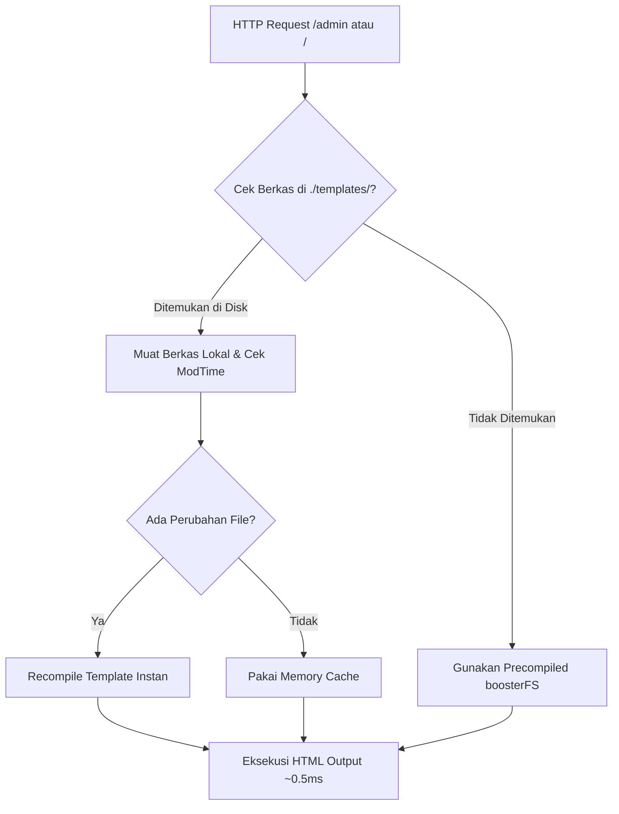

# 🎨 Panduan Kustomisasi Layout & Template Overrides (`vendor:publish`)

> **Kustomisasi tampilan tanpa batas di TGo Booster**  
> Pelajari cara mengekspor template bawaan framework ke proyek lokal Anda, mengubah landing page dan layout admin, serta memanfaatkan fitur *Live Hot-Reloading* tanpa perlu mengompilasi ulang kode Go.

---

## 📑 Daftar Isi

- [1. Konsep Local-First Template Resolution](#1-konsep-local-first-template-resolution)
- [2. Perintah CLI `vendor:publish`](#2-perintah-cli-vendorpublish)
- [3. Membedakan Landing Page Setiap Proyek](#3-membedakan-landing-page-setiap-proyek)
- [4. Kustomisasi Layout & Navbar Admin](#4-kustomisasi-layout--navbar-admin)
- [5. Kustomisasi Tema CSS Admin](#5-kustomisasi-tema-css-admin)
- [6. Live Hot-Reloading & Kinerja](#6-live-hot-reloading--kinerja)
- [7. Struktur Direktori Template](#7-struktur-direktori-template)

---

## 1. Konsep Local-First Template Resolution

Secara default, TGo Booster menyimpan seluruh template HTML dan file CSS di dalam binary Go menggunakan `embed.FS` bawaan Go (`boosterFS`). Ini membuat binary bersifat **standalone**, sangat cepat, dan bisa langsung dijalankan di server tanpa dependensi folder eksternal.

Namun, di dunia nyata setiap proyek sering kali membutuhkan:
- **Landing page yang unik** untuk branding proyek/klien tertentu.
- **Header / Footer custom** pada panel admin.
- **Komponen navigasi khusus** atau modifikasi form sign-in.

TGo Booster mengadopsi mekanisme resolusi template **Local-First**:



- Jika folder `./templates/` di proyek Anda kosong atau belum ada, framework **100% menggunakan template bawaan yang tertanam**.
- Jika Anda menerbitkan berkas tertentu (misalnya `landing.html`), framework **hanya memprioritaskan berkas tersebut**, sementara komponen lainnya tetap bersih ditarik dari core.

---

## 2. Perintah CLI `vendor:publish`

Gunakan binary CLI `booster` langsung di direktori proyek Anda:

```bash
# Menampilkan bantuan dan opsi publish
booster vendor:publish --help
```

### Opsi Tag yang Tersedia

| Flag `--tag` | Berkas yang Diterbitkan | Contoh Penggunaan |
|---|---|---|
| `landing` / `public` | `templates/layouts/landing.html` | Desain landing page publik berbeda tiap project |
| `auth` / `login` | `templates/layouts/auth.html` | Kustomisasi tampilan halaman login admin |
| `layouts` | `templates/layouts/*` & `templates/components/*` | Master layout viewport, topbar, sidebar, modals |
| `pages` | `templates/pages/*` | Tabel data grid, form builder, studio pages |
| `css` / `static` | `static/css/admin.css` | Override stylesheet warna dan font admin |
| `all` | Seluruh template HTML dan CSS | Kontrol penuh atas seluruh visual framework |

### Contoh Eksekusi

```bash
# 1. Terbitkan hanya landing page
booster vendor:publish --tag landing

# 2. Terbitkan layouts dan komponen admin
booster vendor:publish --tag layouts

# 3. Terbitkan custom CSS
booster vendor:publish --tag css

# 4. Timpa berkas lokal jika ingin reset ke template asli bawaan
booster vendor:publish --tag layouts --force
```

---

## 3. Membedakan Landing Page Setiap Proyek

Kasus paling umum: **Panel admin ingin standar sama di semua project, tetapi landing page harus unik.**

### Langkah 1: Terbitkan Hanya Landing Page
Jalankan di direktori proyek:
```bash
booster vendor:publish --tag landing
```
Sistem hanya membuat:
```text
my-project/
└── templates/
    └── layouts/
        └── landing.html
```

### Langkah 2: Ubah Desain Bebas
Buka `templates/layouts/landing.html`. Anda bebas memasukkan markup apa pun:
- Mengganti styling dengan Tailwind CSS, Bootstrap, atau Custom CSS.
- Menambahkan formulir lead generation atau registrasi SaaS.
- Menyesuaikan section Hero, Testimonial, Pricing Table, atau Footer.

### Data Variables yang Tersedia di `landing.html`

| Variabel | Tipe | Deskripsi |
|---|---|---|
| `{{.AppName}}` | `string` | Nama aplikasi dari config / settings |
| `{{.AdminPath}}` | `string` | Prefix URL admin (misal `/admin`) |
| `{{.MetaTitle}}` | `string` | Judul SEO halaman |
| `{{.MetaDescription}}` | `string` | Deskripsi meta tag SEO |
| `{{.OGTitle}}` / `{{.OGImage}}` | `string` | Tag OpenGraph media sosial |
| `{{.Content}}` | `template.HTML` | Konten halaman yang diinjeksi |
| `{{.HeaderScripts}}` | `template.HTML` | Raw scripts Google Analytics / GTM / Meta Pixel |
| `{{.FooterScripts}}` | `template.HTML` | Raw footer scripts |
| `{{.CustomCSS}}` | `template.CSS` | CSS tambahan khusus halaman |
| `{{.CurrentYear}}` | `int` | Tahun berjalan otomatis (misal `2026`) |

---

## 4. Kustomisasi Layout & Navbar Admin

Jika Anda ingin menyesuaikan brand navbar, logo perusahaan, atau menambahkan link khusus di sidebar:

1. Terbitkan komponen layouts:
   ```bash
   booster vendor:publish --tag layouts
   ```
2. Berkas komponen berikut akan siap diedit:
   - `templates/layouts/main.html`: Kerangka induk HTML (head, fonts, body, footer).
   - `templates/components/topbar.html`: Header navbar, pencarian, tenant dropdown switcher, toggle theme, profil user.
   - `templates/components/sidebar.html`: Menu navigasi bertingkat, logo brand.
   - `templates/components/modals.html`: Quick search palette (Ctrl+K), dialog konfirmasi, toasts.

---

## 5. Kustomisasi Tema CSS Admin

Untuk mengubah palet warna primer, border, atau tipografi secara global:

1. Terbitkan berkas CSS:
   ```bash
   booster vendor:publish --tag css
   ```
2. Berkas tersimpan di `static/css/admin.css`.
3. Anda dapat mengubah variabel CSS modern di `:root` maupun `[data-theme="dark"]`:
   ```css
   :root {
     --accent: #2563eb;       /* Ubah warna aksen utama */
     --font-sans: 'Plus Jakarta Sans', sans-serif;
     --radius-md: 10px;
   }
   ```
4. Framework secara otomatis mendeteksi keberadaan file `static/css/admin.css` ini dan memuatnya menggantikan CSS default.

---

## 6. Live Hot-Reloading & Kinerja

TGo Booster dirancang dengan sistem kompilasi dinamis yang sangat efisien:

1. **Pemantauan Waktu Modifikasi (`ModTime`)**:
   - Engine hanya melakukan re-parse template jika ada berkas lokal yang waktu modifikasinya berubah.
   - Tidak ada parsing ulang berulang-ulang untuk request yang sama.
2. **Kecepatan Tinggi (~0.5 ms)**:
   - Setelah template di-compile ke memori, waktu render kembali ke rata-rata sub-milidetik.
3. **Pengalaman Developer Seperti PHP / Blade**:
   - Anda cukup menyimpan perubahan berkas di editor teks (VSCode/GoLand) lalu me-refresh browser. Tidak perlu me-restart proses `go run` atau melakukan rebuild binary!

---

## 7. Struktur Direktori Template

Berikut adalah peta lengkap berkas template jika seluruh tag diterbitkan:

```text
my-app/
├── static/
│   └── css/
│       └── admin.css            # Stylesheet utama admin
└── templates/
    ├── layouts/
    │   ├── main.html            # Master layout admin viewport
    │   ├── auth.html            # Halaman sign in
    │   └── landing.html         # Halaman public / landing
    ├── components/
    │   ├── topbar.html          # Topbar header & tenant switcher
    │   ├── sidebar.html         # Navigasi menu dinamis
    │   └── modals.html          # Command palette Ctrl+K & toasts
    └── pages/
        ├── table.html           # Data grid responsive CRUD
        ├── form.html            # Form builder
        ├── dashboard.html       # Executive analytics dashboard
        ├── module_generator.html# Visual Module Builder Studio
        ├── privileges.html      # RBAC Role Matrix Studio
        ├── menus.html           # Menu Management Studio
        ├── pages.html           # Custom Pages & SEO Studio
        ├── settings.html        # Platform Settings Studio
        └── api_generator.html   # REST API & Token Studio
```
