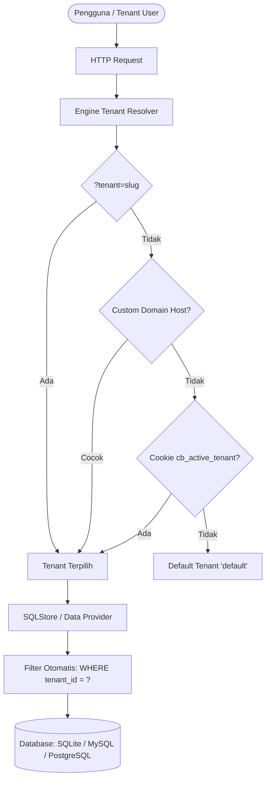

# 🏢 Panduan SaaS Multi-Tenancy & Isolasi Data

> **Fondasi Arsitektur Multi-Tenant Enterprise untuk TGo Booster**  
> Pelajari bagaimana membangun aplikasi SaaS multi-organisasi dengan dukungan Single-Domain, Custom Domain per Tenant, Row-Level Isolation otomatis, dan UI Tenant Switcher.

---

## 📑 Daftar Isi

- [1. Gambaran Umum & Pendekatan Desain](#1-gambaran-umum--pendekatan-desain)
- [2. Cara Mengaktifkan Multi-Tenancy](#2-cara-mengaktifkan-multi-tenancy)
- [3. Strategi Resolusi Tenant Otomatis](#3-strategi-resolusi-tenant-otomatis)
- [4. Isolasi Data Baris (Row-Level Multi-Tenancy)](#4-isolasi-data-baris-row-level-multi-tenancy)
- [5. UI Tenant Switcher di Topbar Navbar](#5-ui-tenant-switcher-di-topbar-navbar)
- [6. Manajemen Tenant di Studio Admin](#6-manajemen-tenant-di-studio-admin)
- [7. Skema Penyimpanan & Custom Domain](#7-skema-penyimpanan--custom-domain)

---

## 1. Gambaran Umum & Pendekatan Desain

TGo Booster menyediakan engine Multi-Tenancy bawaan yang fleksibel untuk berbagai model bisnis SaaS:

1. **Single-Domain by Default (Workspace / Organization Switching)**:
   - Satu domain utama (misal `app.kriva.id` atau `localhost:8080`).
   - Pengguna dapat berpindah antar organisasi/perusahaan yang mereka kelola menggunakan dropdown switcher interaktif di navbar atas tanpa perlu berganti URL atau login ulang.
2. **Dukungan Custom Domain & Subdomain**:
   - Tenant dapat memiliki domain mereka sendiri (misal `erp.acme-corp.com` atau `acme.kriva.id`).
   - Sistem secara otomatis memetakan HTTP request `Host` ke tenant yang sesuai.
3. **Row-Level Data Isolation**:
   - Seluruh data tabel modul bisnis secara otomatis memiliki kolom `tenant_id` dan indeks performa tinggi.
   - Query `FindAll`, `FindByID`, `Update`, `Delete`, dan `Create` otomatis terisolasi per tenant aktif.



---

## 2. Cara Mengaktifkan Multi-Tenancy

Di file `main.go` aplikasi Anda:

```go
package main

import (
    "github.com/tokalink/tgo"
    "github.com/tokalink/tgo-booster/pkg/cb"
)

func main() {
    kernel := tgo.New()

    admin := cb.NewEngine(cb.EngineConfig{
        AppName:   "SaaS ERP Platform",
        AdminPath: "/admin",
    })

    // Aktifkan Multi-Tenancy di level framework
    admin.EnableMultiTenancy(true)

    // Pasang middleware & route
    kernel.Use(admin.Middleware())
    admin.RegisterRoutes(kernel.Router())

    kernel.Run(":8080")
}
```

---

## 3. Strategi Resolusi Tenant Otomatis

Engine `ResolveTenant` di TGo Booster mengevaluasi tenant dengan prioritas berlapis berikut:

1. **Query Parameter URL**:
   Contoh: `http://localhost:8080/admin/items?tenant=demo-enterprise`
   *(Sangat berguna untuk integrasi API atau testing antar workspace)*.
2. **Custom Domain (Host Matching)**:
   Contoh: Request masuk dari `erp.pt-maju.co.id` yang telah terdaftar pada properti `CustomDomain`.
3. **Subdomain Matching**:
   Contoh: `pt-maju.kriva.id` otomatis memetakan ke tenant dengan slug `pt-maju`.
4. **HTTP Request Header**:
   Header `X-Tenant-Slug: demo-enterprise` *(berguna untuk panggilan Mobile App / Headless API)*.
5. **Session Cookie**:
   Cookie terenkripsi `cb_active_tenant` yang disetel saat user memilih organisasi di dropdown navbar.
6. **User Account Default**:
   Organisasi default yang terhubung ke akun user yang sedang login.
7. **Default Fallback**:
   Jika tidak ada yang cocok, sistem mengarahkan ke tenant default (`default`).

---

## 4. Isolasi Data Baris (Row-Level Multi-Tenancy)

Pada controller CRUD deklaratif Anda, cukup panggil `SetTenantScoped(true)` pada model store:

```go
func NewAdminItemsController(e *cb.Engine, db *sql.DB) *cb.Controller {
    // 1. Buat SQLStore untuk tabel "items"
    store := cb.NewSQLStore(db, "items", "id", e)

    // 2. Aktifkan isolasi tenant
    store.SetTenantScoped(true)

    // 3. Jalankan AutoMigrate
    // Kolom 'tenant_id VARCHAR(64) NOT NULL DEFAULT 'default''
    // beserta indeks 'idx_items_tenant_id' akan otomatis dibuat jika belum ada!
    store.AutoMigrate(map[string]string{
        "sku":         "VARCHAR(64) NOT NULL UNIQUE",
        "name":        "VARCHAR(150) NOT NULL",
        "price":       "DECIMAL(12,2) NOT NULL DEFAULT 0.00",
        "description": "TEXT",
    })

    ctrl := cb.NewController("items", "Master Items", "Daftar Barang", e, store)
    // ... konfigurasi kolom dan form ...
    return ctrl
}
```

### Keamanan Otomatis
- **Pencarian (`FindAll`)**: Otomatis menambahkan klausa `AND tenant_id = ?`.
- **Detail (`FindByID`)**: Data milik tenant lain tidak akan bisa diakses sekalipun ID diketahui.
- **Pembaruan & Hapus (`Update` / `Delete`)**: Otomatis diberi filter `tenant_id = ?`.
- **Penyimpanan Baru (`Create`)**: `tenant_id` tenant yang sedang aktif langsung disuntikkan secara aman di sisi server.
- **Bypass Superadmin**: Jika user memiliki izin global (`TenantSlug == "*"`), data seluruh tenant dapat diawasi untuk keperluan audit.

---

## 5. UI Tenant Switcher di Topbar Navbar

Ketika `admin.EnableMultiTenancy(true)` aktif, navbar atas otomatis menampilkan **Tenant Switcher Dropdown**:

- **Informasi Tenant Aktif**: Menampilkan nama workspace, slug, dan badge tingkatan paket (`Enterprise`, `Pro`, `Starter`, `Free`).
- **Pilihan Workspace Instan**: Mengklik tenant lain di dropdown akan memanggil `/admin/tenants/switch/:slug` yang memperbarui cookie session dan me-refresh halaman secara instan.
- **Tampilan Solid & Aksesibel**: Dropdown berlatar belakang solid opaque (putih pada mode terang, `#141824` pada mode gelap) dengan dukungan navigasi tombol `Escape` untuk menutup.

---

## 6. Manajemen Tenant di Studio Admin

Kelola seluruh organisasi pelanggan Anda melalui antarmuka bawaan:

- Akses URL: **`/admin/tenants`**
- Fitur yang tersedia:
  - **Tambah Organisasi Baru**: Menentukan nama, slug URL unik, status aktif, dan paket plan.
  - **Custom Domain Binding**: Mengaitkan nama domain pelanggan ke workspace mereka.
  - **Kapasitas Pengguna & Storage**: Mengatur kuota `MaxUsers` dan `MaxStorageMB`.
  - **Fitur Tambahan**: Mengaktifkan/menonaktifkan modul spesifik per tenant.

---

## 7. Skema Penyimpanan & Custom Domain

Daftar tenant disimpan secara terpusat pada `data/tenants.json` yang thread-safe:

```json
[
  {
    "id": "tenant-default",
    "name": "Default Workspace",
    "slug": "default",
    "plan": "Enterprise",
    "is_active": true,
    "max_users": 100,
    "created_at": "2026-10-05T08:00:00Z"
  },
  {
    "id": "tenant-demo-ent",
    "name": "Demo Enterprise Corp",
    "slug": "demo-enterprise",
    "custom_domain": "demo.kriva.id",
    "plan": "Enterprise",
    "is_active": true,
    "max_users": 500,
    "created_at": "2026-10-05T08:00:00Z"
  }
]
```

Konfigurasi ini menjamin kemudahan backup, portabilitas tinggi, dan kesiapan deploy di server Docker / Kubernetes.
